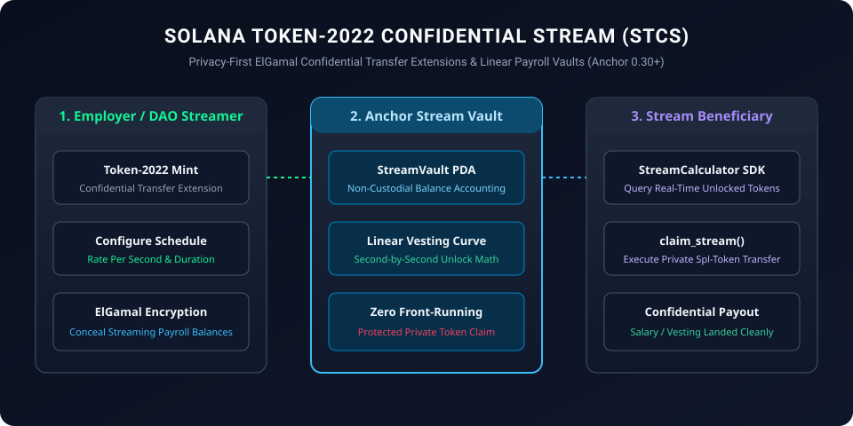

# Solana Token-2022 Confidential Stream (STCS)

<p align="center">
  
</p>

[](LICENSE)
[](https://solana.com)
[](https://spl.solana.com/token-2022)
[](https://www.typescriptlang.org)

**Solana Token-2022 Confidential Stream (STCS)** is a privacy-first streaming payroll and token vesting protocol leveraging **Solana SPL Token-2022 confidential transfer extensions (ElGamal encryption and twisted ElGamal proofs)** and non-custodial streaming vaults.

---

## ⚡ Core Capabilities

1. **Confidential Balance Vesting**: Uses Token-2022 ElGamal ciphertexts to conceal continuous streaming balances and employee pay rates from public block explorers.
2. **Deterministic Linear Stream Curve**: Second-by-second linear unlocks with zero front-running vulnerability.
3. **Emergency Clawback & Pausing**: Sponsoring organizations can halt unvested streams upon employment termination while leaving vested funds intact.

---

## 🛠 Smart Contracts & Client SDK

- **`programs/confidential_stream/src/lib.rs`**: Anchor Rust program (`Anchor 0.30+`):
  - `initialize_stream_vault`: Configures Token-2022 mint, beneficiary, rate-per-second, and clawback flags.
  - `claim_vested_confidential`: Calculates unlocked portion and forwards Token-2022 transfer instructions.
- **`src/stream_calculator.ts`**: Pure TypeScript linear vesting curve evaluator.
- **`src/token2022_client.ts`**: High-performance transaction bundle builder using `@solana/web3.js` and `@solana/spl-token`.
- **`tests/stream.test.ts`**: Automated unit test suite.

---

## 🚀 Quick Start

### Installation

```bash
git clone https://github.com/circularmarke/solana-token2022-confidential-stream.git
cd solana-token2022-confidential-stream
npm install
npm test
```

---

## 📜 License

Licensed under the [Apache License, Version 2.0](LICENSE).
